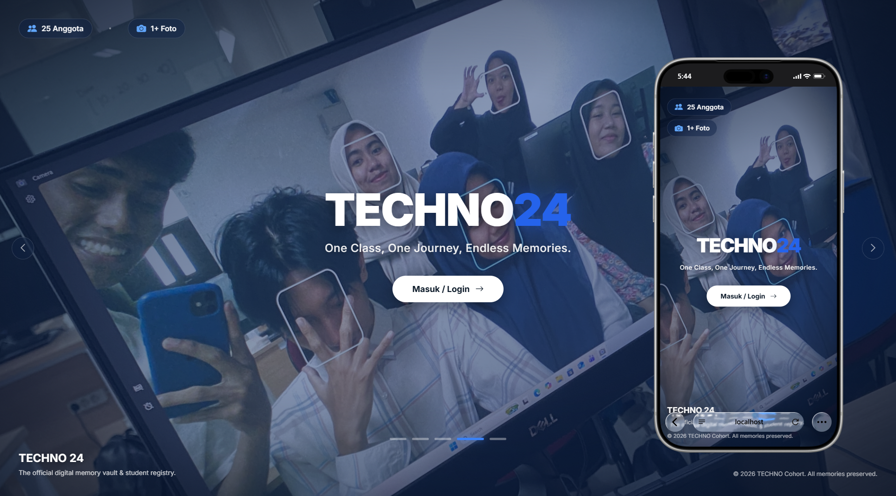

<div align="center">

# 🎓 TECHNO 24

### *One Class, One Journey, Endless Memories.*

[](https://php.net)
[](https://mariadb.org)
[](https://icons.getbootstrap.com)
[](.)

> **TECHNO 24** adalah platform digital resmi untuk kelas TECHNO angkatan 2024 — sebuah *digital memory vault* dan *student registry* yang menyimpan seluruh kenangan, informasi, dan kehidupan kelas dalam satu atap.

</div>

---

<div align="center">



</div>

## 📖 Tentang Proyek

TECHNO 24 adalah website kelas berbasis PHP yang dirancang khusus untuk mempererat hubungan anggota kelas, menyimpan kenangan bersama, dan mempermudah pengelolaan informasi kelas secara terpusat. Dengan tampilan modern bertema navy-blue dan foto-foto kelas sebagai latar belakang animasi, website ini menghadirkan pengalaman yang personal dan berkesan.

Website ini memiliki dua peran utama:
- **Anggota** — dapat mengakses jadwal, pengumuman, galeri, story, dan berbagai fitur kelas.
- **Admin / Bendahara** — dapat mengelola seluruh konten, anggota, dan keuangan kelas.

---

## ✨ Fitur Utama

### 🏠 Landing Page
- Slideshow foto otomatis dari folder kelas dengan animasi *Ken Burns effect*
- Statistik real-time: jumlah anggota aktif & total foto kelas
- Desain full-screen immersive dengan *glassmorphism* dan gradient overlay

### 📊 Dashboard
- Ringkasan jadwal kuliah hari ini & mata kuliah berikutnya
- Pengumuman terbaru & agenda mendatang dalam satu tampilan
- Preview foto terbaru dari galeri
- Panel statistik admin (akun, foto, album, story, agenda)

### 📅 Jadwal Kuliah
- Jadwal mingguan per hari & jam (Senin–Minggu)
- Informasi ruangan dan mata kuliah lengkap

### 📢 Pengumuman
- Kategori: Akademik, Uang Kas, Kegiatan Kelas, Perubahan Jadwal, Informasi Umum
- Dukungan pin & tandai sebagai *penting*
- Notifikasi otomatis ke seluruh anggota saat pengumuman baru dibuat

### 🗓️ Agenda Kelas
- Manajemen event/kegiatan dengan status lengkap: ide → direncanakan → dikonfirmasi → berlangsung → selesai
- RSVP anggota (ikut / tidak ikut)
- Estimasi biaya per anggota & target peserta
- Konfirmasi dua langkah oleh admin

### 💰 Kas Kelas
- Pengelolaan periode kas dengan nominal yang ditetapkan admin
- Upload bukti pembayaran (struk/screenshot)
- Status pembayaran: pending → verified / rejected
- Laporan kas lengkap & histori transaksi

### 📸 Galeri & Album
- Upload foto/video oleh anggota
- Pengelompokan ke dalam album bertema
- Tampilan grid masonry yang elegan
- Lightbox preview foto

### 📖 Story
- Story 24 jam mirip Instagram Stories
- Upload foto/video singkat
- Tampilan avatar story di dashboard

### 📔 Diary
- Catatan pribadi anggota yang bersifat privat
- Ruang ekspresi digital untuk setiap anggota

### 📝 Polling
- Buat voting/polling kelas
- Tampilan hasil real-time

### 🔔 Notifikasi
- Sistem notifikasi in-app
- Broadcast otomatis saat ada pengumuman baru

### 👤 Profil & Anggota
- Halaman profil personal dengan avatar
- Direktori anggota kelas

### 🔐 Admin Panel
- Manajemen pengguna (aktifkan/nonaktifkan akun)
- Panel admin tersendiri di `/admin`
- Audit log aksi admin

---

## 🗂️ Struktur Direktori

```
techno24/
├── 📄 index.php              # Landing page (publik)
├── 📄 login.php              # Halaman login
├── 📄 logout.php             # Proses logout
├── 📄 dashboard.php          # Dashboard utama (perlu login)
├── 📄 setup.php              # Setup awal aplikasi
│
├── 📁 pages/                 # Halaman fitur utama
│   ├── agendas.php           # Manajemen agenda
│   ├── albums.php            # Album foto
│   ├── announcements.php     # Pengumuman kelas
│   ├── cash.php              # Kas anggota (bayar)
│   ├── cash_manage.php       # Kelola kas (admin/bendahara)
│   ├── cash_report.php       # Laporan kas
│   ├── diaries.php           # Diary pribadi
│   ├── gallery.php           # Galeri foto & video
│   ├── members.php           # Direktori anggota
│   ├── notifications.php     # Pusat notifikasi
│   ├── photo.php             # Detail foto
│   ├── polls.php             # Polling kelas
│   ├── profile.php           # Profil pengguna
│   ├── receipt.php           # Kwitansi kas
│   ├── schedules.php         # Jadwal kuliah
│   └── stories.php           # Story 24 jam
│
├── 📁 admin/                 # Panel admin
│   ├── index.php             # Dashboard admin
│   └── users.php             # Manajemen pengguna
│
├── 📁 includes/              # Core framework (helper, auth, dll)
├── 📁 config/                # Konfigurasi database & aplikasi
├── 📁 assets/                # CSS, JS, dan gambar statis
│   ├── css/
│   ├── js/
│   └── images/
├── 📁 database/              # Skema SQL
│   └── techno24_db.sql
├── 📁 file/                  # File background slideshow
│   └── images/               # Foto kelas untuk landing page
├── 📁 uploads/               # File upload pengguna
└── 📁 storage/               # Penyimpanan internal
```

---

## 🛠️ Tech Stack

| Komponen | Teknologi |
|----------|-----------|
| **Backend** | PHP 8.2+ |
| **Database** | MySQL / MariaDB 10.4+ |
| **Frontend** | Vanilla HTML, CSS, JavaScript |
| **Icons** | Bootstrap Icons 1.11 |
| **Font** | Google Fonts – Inter |
| **Server** | Apache (dengan `.htaccess`) |

---

## 🔒 Keamanan

- **CSRF Protection** — Semua form POST dilindungi token CSRF
- **Login Throttling** — Maksimal 5 percobaan gagal, dikunci 15 menit
- **Session-based Auth** — Autentikasi berbasis sesi PHP yang aman
- **Audit Log** — Semua aksi admin tercatat di tabel audit
- **Input Sanitization** — Semua input di-*escape* sebelum ditampilkan
- **File Validation** — Validasi tipe & ukuran file upload (maks 4 MB gambar, 19 MB video)

---

## 📋 Changelog

| Versi | Tanggal | Keterangan |
|-------|---------|------------|
| 1.0.0 | Oktober 2026 | Rilis pertama — fitur lengkap |

---

<div align="center">

**© 2026 TECHNO 24 Cohort. All memories preserved. ❤️**

*Dibuat dengan penuh kenangan untuk kelas TECHNO angkatan 2024.*

</div>
